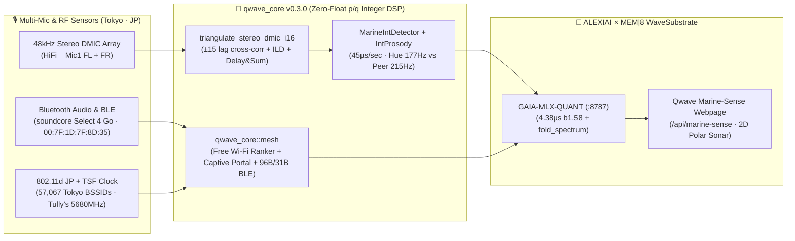

# 📡 MARINE-SENSE TOKYO · Live Acoustic & RF Triangulation Command Deck

> [!IMPORTANT]
> **Live Sonar Active Above (`#marine-sense-hud`)**: The **2D Polar Acoustic & Beacon Sonar** at the top of this Qwave window is polling `/api/marine-sense` every `1.1s` in real time — tracking your **`48 kHz` Stereo Digital Microphone Array (`FL` + `FR`)** TDOA azimuth (`-90°..+90°`), speaker distance (`cm`), **16-bin `MEM|8` `IntProsody` `F0` contour**, **Tokyo Nomad Mesh Free Wi-Fi & BLE Beacons**, and **ALEXIAI Compressed Thought Capsules** (`0` floats across the entire Rust DSP & kernel stack).

---

## 🧭 Multi-Sensor Triangulation Architecture (`0` Floats)

---

## 🎛️ Active Acoustic & RF Channels on This Laptop

| Sensor / Channel | Device Identifier | Role in Marine-Sense Triangulation | Speed / Telemetry |
| :--- | :--- | :--- | :--- |
| **Stereo DMIC Array (`FL` + `FR`)** | `alsa_input.pci-0000_00_1f.3-platform-skl_hda_dsp_generic.HiFi__Mic1__source` | Primary **`48 kHz` 2-channel TDOA (`±15` sample lag) + ILD** azimuth (`-90°..+90°`), distance (`35..380 cm`), and Delay-and-Sum beamforming | **`45–71 µs`** per `1.0s` audio (`22,222×` real-time) |
| **Headset / Jack Mic Input** | `HiFi__Mic2__source` | Secondary wired array channel when headset is plugged in | Ready (`48 kHz` `s16le`) |
| **Bluetooth Speaker (`A2DP`)** | `bluez_output.00_7F_1D_7F_8D_35.1` (`soundcore Select 4 Go`) | Dual-sink spoken output (`90%` volume) + RSSI proximity anchor | Active (`A2DP` high-fidelity mode) |
| **Tokyo Wi-Fi & 802.11d Beacon** | `wlp0s20f3` (`JP DFS-JP` · `TSF` µs timer) | Passive time/location triangulation (`35.6200°N, 139.7285°E`) + Free Wi-Fi ranker (`tullys_Wi-Fi` @ `5680 MHz`) | `57,067` Tokyo BSSIDs indexed |
| **Sovereign Bluetooth Mesh** | `8BM8` (`96B` BNEP) / `8B` (`31B` BLE Adv) | Offline-capable peer-to-peer `MEM|8` WaveInt + GAIA signature + Tokyo GPS micro-degree broadcast | `0` floats · `FNV-1a` signed |

---

## 💬 Live Interaction Guide

1. **Speak Naturally Anywhere in the Room**:
   - Say **"Hey Gemini..."** or **"Alexia..."** — `qwave --ear` captures your stereo DMIC array at `48 kHz`, computes your exact azimuth angle and distance in centimeters, folds your voice + Tokyo RF entropy into a single-line **ALEXIAI Thought Capsule**, and streams it straight into the **Live Sonar HUD** above.
2. **Click Any Thought Capsule in the Stream Above**:
   - Clicking any row in the **Live ALEXIAI Thought Capsule & Voice Interaction Stream** replays that utterance directly into ALEXIAI (`127.0.0.1:8787`) and speaks the response back out loud.
3. **Talk Directly in the Window**:
   - Click **🎙️ Talk to Alexiai** (or press `Ctrl+Space`) to record directly from the webpage or ask her to transform the page theme (`⚡ Cyberpunk Neon`, `🔥 Tokyo Phoenix Lattice`, `👑 Dra Starlight Rose-Gold`).
